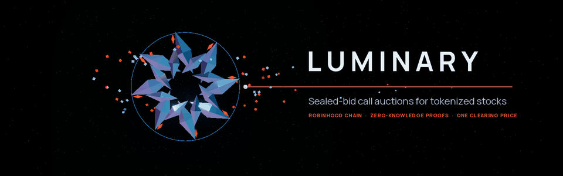
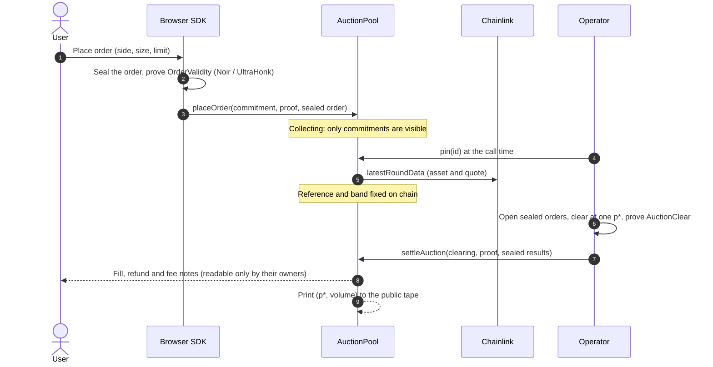
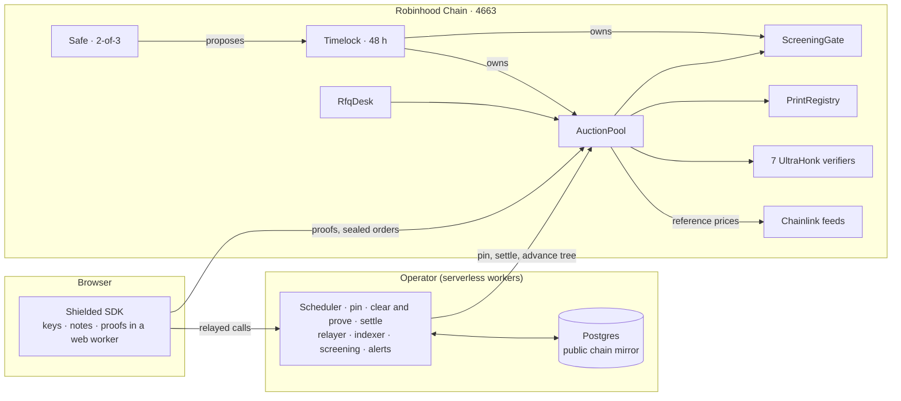

<div align="center">

<picture>
  <source srcset=".github/assets/banner.webp" type="image/webp" />
  
</picture>

<br />

[](https://github.com/luminaryRH/Luminary-stack/actions/workflows/ci.yml)
[](https://robinhoodchain.blockscout.com/address/0xC6201e94FF6Ce6DD9a5918C493f9dE9d897Da33F)
[](contracts/foundry.toml)
[](circuits)
[](#testing-and-verification)
[](#testing-and-verification)
[](LICENSE)

**[App](https://luminariesrh.com)** · **[How it works](#how-it-works)** · **[Deployments](#deployments)** · **[Security model](#security-model)** · **[Build & test](#build-and-test)**

</div>

---

## Overview


Luminary is a venue for **sealed-bid, uniform-price call auctions** of tokenized stocks on Robinhood Chain. Balances,
orders and fills live in a **shielded note pool**, so what a participant holds and bids stays private, while every
clearing result is public and verified on chain.

- **Sealed orders.** An order is encrypted in the browser and proven valid with a zero-knowledge proof before it rests
  in an auction. Nobody sees the book.
- **One clearing price.** At the call, every crossable order fills at a single price `p*` that maximizes volume inside
  a band around the Chainlink reference. The contract checks the clearing with an `AuctionClearProof` without ever
  seeing an order.
- **Public prints.** Each settlement writes its price and volume to a public tape in the same transaction.
- **Always an exit.** Cancels, reclaims and the `ragequit` (a depositor's own value back to their own address) need
  nothing from the operator, the owner or a pause.

Markets: **TSLA, AMZN, AMD, PLTR** (Robinhood stock tokens), quoted in **USDG**. Auctions call at **09:30 ET** (open),
**16:00 ET** (close) and **00:00 UTC**, plus two-party **RFQ blocks** that cross whole at the reference.

## How it works



Every state change is backed by a proof checked against a bb-generated UltraHonk verifier:

| Circuit | Proves |
| --- | --- |
| `deposit` | the queued note holds exactly the asset and amount the pool received |
| `tree_update` | a batch of notes was appended to the Merkle root (no Poseidon on chain) |
| `transact` | up to two notes become two notes, releasing an amount to a recipient and a fee to a relayer |
| `order_validity` | an order locks part of a note the sender owns, above the market minimum, with valid terms |
| `auction_clear` | 64 orders cleared at one `p*` inside the band, volume maximized, every output correct |
| `reclaim` | an order's owner takes the lock back (cancel, voided auction or left-out order) |
| `rfq_cross` | a two-party block crossed whole at the reference, or both sides refunded |

## Architecture



| Layer | Stack |
| --- | --- |
| Contracts | Solidity 0.8.28 (Foundry), no proxies, no `delegatecall`, transient-storage reentrancy lock |
| Circuits | Noir 1.0.0-beta.22, UltraHonk (Barretenberg), keccak transcript for the EVM verifiers |
| Client | TypeScript SDK, proofs generated in the browser with `noir_js` and `bb.js` |
| Operator | TanStack Start API routes on serverless functions, Postgres, scheduled workers |
| Oracles | Chainlink feeds on Robinhood Chain (0.5% deviation, 24 h heartbeat) |
| Governance | Safe 2-of-3 → OpenZeppelin `TimelockController` (48 h) |

## Deployments

**Robinhood Chain mainnet (chain ID 4663)** · explorer [robinhoodchain.blockscout.com](https://robinhoodchain.blockscout.com)

| Contract | Address |
| --- | --- |
| AuctionPool | [`0xC6201e94FF6Ce6DD9a5918C493f9dE9d897Da33F`](https://robinhoodchain.blockscout.com/address/0xC6201e94FF6Ce6DD9a5918C493f9dE9d897Da33F) |
| RfqDesk | [`0xeA1C416d50a076bC69cD8B00A1346F8EFBB4057A`](https://robinhoodchain.blockscout.com/address/0xeA1C416d50a076bC69cD8B00A1346F8EFBB4057A) |
| ScreeningGate | [`0x354153a447b978b38c3a01E2503ad99e2796bdc5`](https://robinhoodchain.blockscout.com/address/0x354153a447b978b38c3a01E2503ad99e2796bdc5) |
| PrintRegistry | [`0x725721E2F9E332c0927fF6d895702E2A913f0F9F`](https://robinhoodchain.blockscout.com/address/0x725721E2F9E332c0927fF6d895702E2A913f0F9F) |
| DisclosureRegistry | [`0x8d366b92FD161e8b57a046d6046A06Df6b77C2e6`](https://robinhoodchain.blockscout.com/address/0x8d366b92FD161e8b57a046d6046A06Df6b77C2e6) |
| Owner · TimelockController (48 h) | [`0x7E52e5b210034DC3B252Faf740300A406C6eAd87`](https://robinhoodchain.blockscout.com/address/0x7E52e5b210034DC3B252Faf740300A406C6eAd87) |
| Safe (2-of-3, proposer and guardian) | [`0x6Cc54Bb49D9f26b2968A09F2019021D77381EA97`](https://robinhoodchain.blockscout.com/address/0x6Cc54Bb49D9f26b2968A09F2019021D77381EA97) |

The full manifest, including the verifiers and the token and feed addresses, is
[`contracts/deployments/4663.json`](contracts/deployments/4663.json). `script/PostDeployCheck.s.sol` verifies, read-only,
that the live bytecode is this build and that ownership, roles, markets and screening are configured as intended.

## Security model

| | |
| --- | --- |
| **Custody** | Funds are notes in the pool; every movement is a proof. No role can move a user's notes or mint notes. |
| **Governance** | A 2-of-3 Safe controls a 48-hour timelock that owns the pool and the gate. Every owner action is public 48 hours before it can run. The deployer holds no role. |
| **Emergency stop** | The Safe, as guardian, can pause deposits or halt a market immediately. Only the timelock can resume either. Exits stay open. |
| **Prices** | The pool reads Chainlink at the call and voids an auction whose round is older than its market's limit. Nobody pushes prices. |
| **Screening** | Withdrawals and orders prove their deposit is in a screened association set (sanctions list and blocklist). A depositor left out can always ragequit. |
| **Order privacy** | Today one operator key opens sealed orders at settlement, so the operator can read orders before the call. A threshold committee is built in: members verify every request on chain and decrypt only after an auction is pinned. |
| **Monitoring** | Alerts on every timelock, Safe and admin event, large outflows, voided auctions, operator gas and stalled workers. |

> [!IMPORTANT]
> Luminary has no external security audit. Interact only with amounts you can afford to lose, and only where you are
> eligible: the service is intended for non-US participants in permitted jurisdictions.

## Repository layout

```text
contracts/          Foundry project: pool, desk, gate, registries, generated verifiers, deploy and post-deploy check
circuits/           Noir workspace: deposit, tree_update, transact, order_validity, reclaim, auction_clear, rfq_cross
src/shielded/       Browser SDK: keys, sealing, ledger rebuild, proving, orders, RFQ
src/server/         Operator workers: scheduling, clearing engine, settlement, relayer, indexer, screening, alerts
src/routes/api/     Public API and worker endpoints
supabase/           Database schema and SQL functions (public chain mirror, auctions, prints)
test/               End-to-end suite on a local chain and the coverage runner
scripts/            Committee member client, verifier generation, migrations, coverage
```

## Build and test

**Prerequisites:** [Bun](https://bun.sh) 1.3.13, Node.js 24, [Foundry](https://getfoundry.sh) v1.5.1,
[Noir](https://noir-lang.org) 1.0.0-beta.22.

```bash
git clone https://github.com/luminaryRH/Luminary-stack.git && cd Luminary-stack

# app and server: frozen install with install scripts disabled, then checks and type check
bun install --frozen-lockfile --ignore-scripts
bun run check
bunx tsc --noEmit

# contracts
cd contracts
git clone --depth 1 --branch v1.16.2 https://github.com/foundry-rs/forge-std lib/forge-std
git clone --depth 1 --branch v5.7.0 https://github.com/OpenZeppelin/openzeppelin-contracts lib/openzeppelin-contracts
forge test
FORK_RPC_URL=https://rpc.mainnet.chain.robinhood.com forge test --match-contract ForkTest
cd ..

# end-to-end on a local chain, with the off-chain coverage report
bun scripts/coverage.ts

# circuits
cd circuits && nargo test --workspace
```

## Testing and verification

| Check | Result |
| --- | --- |
| Contract tests (Foundry) | 80 tests, including a full deploy rehearsed on a mainnet fork |
| Stateful invariants | 4 invariants × 128,000 calls: conservation, single spend, slot consistency |
| Contract line coverage | 99.4% (100% of functions) |
| Mutation testing (Gambit) | 90.4% of 893 mutants killed |
| Symbolic checks (Halmos) | 7 properties proven for every input |
| Circuit tests (nargo) | 53 tests, including failure cases for every constraint |
| End-to-end (local chain) | deposits, sealed orders, settlement, RFQ, withdrawals, ragequit, screening, committee, alerts |
| Off-chain line coverage | 95.6% of the SDK, workers and API |

Every push runs the full suite in CI, together with Slither, Semgrep and a gitleaks secret scan; every Action is
pinned to a commit.

## Security disclosure

Please report vulnerabilities privately through **GitHub private vulnerability reporting**
(Security → Report a vulnerability). Do not open a public issue, and do not test against the live pool with funds you
do not own; `forge test` on a fork reproduces the deployment.

## License

Released under the [MIT License](LICENSE).

<br />

<div align="center">
  
  <br />
  <sub><b>Luminary</b> · Private intent. Verifiable outcomes.</sub>
</div>
